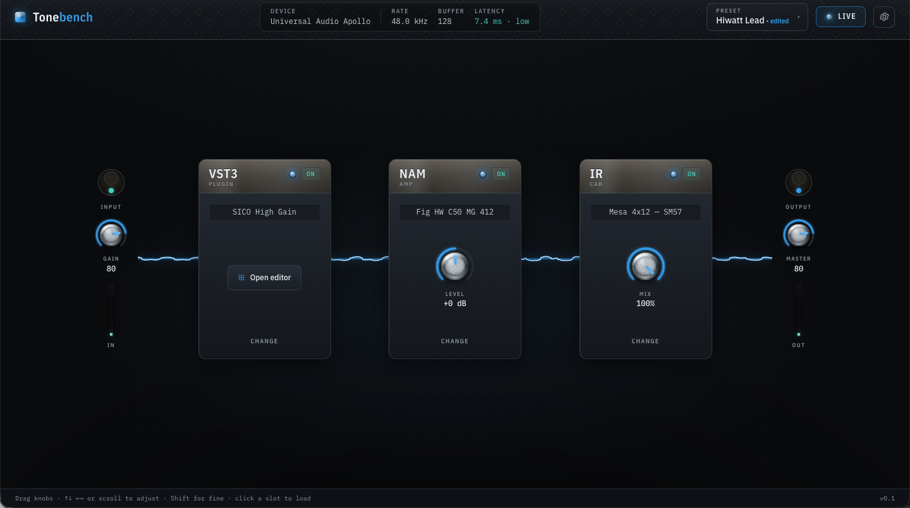

# Tonebench

A small, fast macOS app for playing guitar through amp sims. Load a VST3 plugin, a Neural Amp
Modeler model, and an impulse-response cab, chain them up, and play. That's the whole idea.

<picture>
  <source srcset="site/assets/hero.webp" type="image/webp">
  
</picture>

Early days: this is v0.1.0. macOS builds now, and Linux and Windows build in CI (details below).

## Why I built this

A friend of mine built a guitar amp and sent it over as a VST3 plugin. I wanted to actually play
through it, and I didn't want to buy a whole amp-sim app just to try out the one amp he'd made.

I've paid for a few apps like this before. The cheaper ones tend to run out of features fast. The
expensive ones go the other way: fiddly, and stuffed with things I'm never going to touch. I wanted
something in between. Something small and simple where I could drop his VST in next to the NAM models
and the impulse-response cabs I was already using, and flip each part of the chain on and off.

His plugin turned out really good and worked a treat, and building a little rig around it was a lot
of fun. I'm happy with where it ended up.

## What it does

- Loads VST3 plugins: amps, drives, effects.
- Loads NAM (Neural Amp Modeler) `.nam` amp models. If a model's sample rate doesn't match your
  interface, it resamples in real time so you don't have to care.
- Loads impulse responses for cab sims, with no added latency.
- Runs the three as an ordered chain (plugin, then amp, then cab), and you can bypass any slot.
- Saves and recalls whole rigs as presets.
- Shows the live signal moving through the chain while you play.

Under the hood it's a C++/JUCE audio engine with a React interface in a webview. The interface runs
on its own thread, so it never costs you any latency.

## Build

You'll need CMake, Ninja, Node/npm, and the Xcode command-line tools (macOS, Apple Silicon or Intel).

```sh
# Install the UI deps once. CMake builds and embeds the React UI on every build after that.
cd ui && npm install && cd ..

# The first configure pulls in JUCE and the NAM core.
cmake -B build -G Ninja -DCMAKE_BUILD_TYPE=RelWithDebInfo
cmake --build build --target Tonebench

open build/Tonebench_artefacts/RelWithDebInfo/Tonebench.app
```

The `tonebench_ui` target runs `npm run build` and packs the UI into `assets/webui.zip` for you (it's
generated at build time, not committed), so the embedded UI can't drift out of date.

## Test

```sh
ctest --test-dir build --output-on-failure   # C++ engine suite: DSP checks, realtime safety, presets
cd ui && npm test                             # UI unit tests: bridge logic, Knob, Meter
```

`tonebench_cli` also renders audio offline, through a simulated interface, so no device is needed:

```sh
cmake --build build --target tonebench_cli
./build/tonebench_cli_artefacts/RelWithDebInfo/tonebench_cli render \
    --gen pluck --nam model.nam --ir cab.wav --out out.wav
```

See [`docs/testing.md`](docs/testing.md) for what's covered. CI runs both suites on every push.

## Download

Tagged releases publish ready-to-run builds for macOS, Linux, and Windows on the
[Releases](https://github.com/jcjmcclean/tonebench/releases) page.

The macOS build is self-signed, so the first time you open it, right-click the app and choose Open,
then Open again. You only do this once. After that, approve the microphone prompt so it can hear your
guitar. To build a Universal DMG yourself (runs on both Intel and Apple Silicon):

```sh
cmake -B build-rel -G Ninja -DCMAKE_BUILD_TYPE=RelWithDebInfo -DTONEBENCH_UNIVERSAL=ON
cmake --build build-rel --target Tonebench
./packaging/make-dmg.sh      # writes dist/Tonebench-<version>.dmg
```

[`docs/distribution.md`](docs/distribution.md) covers signing, notarization, and the Linux and
Windows specifics.

## How it works

The audio engine is C++ on JUCE 8: CoreAudio in and out, VST3 hosting, NAM inference, and IR
convolution, all run as an ordered chain on the realtime audio thread with no allocations or locks in
the hot path. NAM models run at 48 kHz; a Lagrange resampler handles other device rates around them.
IR uses `juce::dsp::Convolution` and adds no latency. The UI is React and TypeScript (built with Vite)
inside a JUCE webview, talking to the engine over a native JavaScript-to-C++ bridge, on a separate
thread from audio.

One thing worth knowing up front: loading a VST3, or opening a `.tonebench` preset someone shared with
you, runs third-party code inside an app that has microphone access. Only load plugins and presets you
trust, the same as you would with any amp sim.

## Licence

Tonebench is under the GNU Affero General Public License v3.0 (see [`LICENSE`](LICENSE)). It has to be:
it builds on JUCE, whose free licence is AGPLv3, so Tonebench's source is open and stays that way. You
can use it, read it, change it, and pass it on under those terms.

Built with:
- [JUCE 8](https://juce.com), the audio framework (AGPLv3 or commercial; used here under AGPLv3)
- [NeuralAmpModelerCore](https://github.com/sdatkinson/NeuralAmpModelerCore) by Steven Atkinson (MIT)
- [Eigen](https://eigen.tuxfamily.org) (MPL2)
